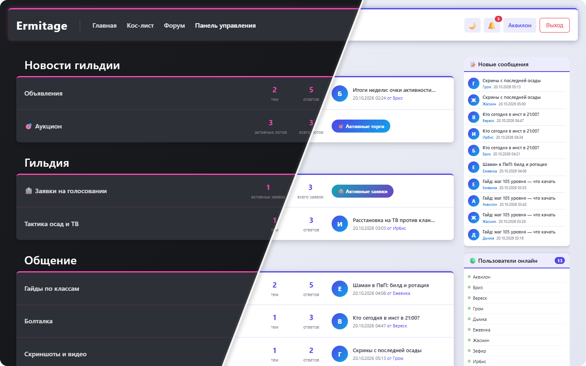
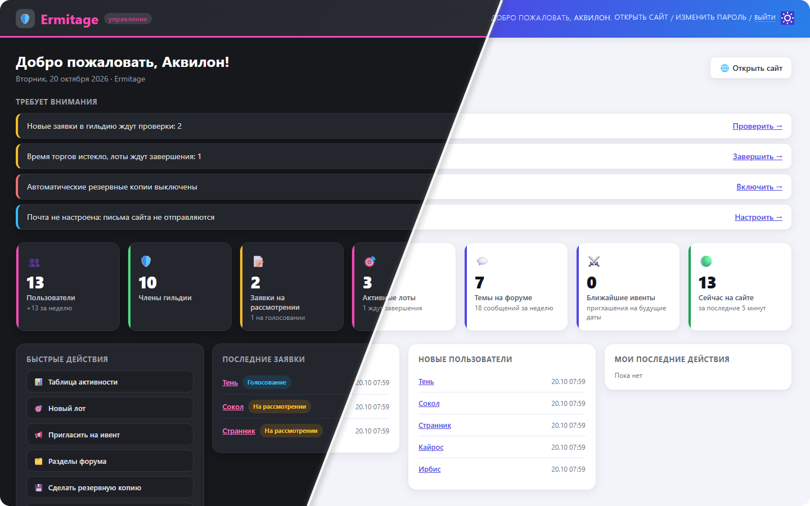

<div align="center">

<h1>⚔️ Сайт гильдии Perfect World</h1>

<p><b>Форум, приём в гильдию с голосованием, аукцион за очки активности, ивенты и кос-лист —<br>на своём сервере одной командой</b></p>

<p>
  
  
  
  
  
  <a href="LICENSE"></a>
</p>

<p>
  <a href="#возможности">Возможности</a> ·
  <a href="#установка">Установка</a> ·
  <a href="#первая-настройка">Первая настройка</a> ·
  <a href="#резервные-копии">Резервные копии</a> ·
  <a href="#решение-проблем">Решение проблем</a>
</p>



<sub>Тёмная и светлая тема переключаются одной кнопкой рядом с уведомлениями</sub>

</div>

<br>

Готовый сайт для гильдии в Perfect World: форум, приём заявок с голосованием, аукцион за очки активности, запись на ивенты, кос-лист и уведомления. Ставится на свой сервер одной командой, HTTPS-сертификат получается автоматически. Название гильдии, иконку сайта, почту, капчу и все разделы вы настраиваете в админ-панели — править код не нужно.

## Возможности

- **Форум** — категории, подкатегории, темы и ответы с картинками. Для каждого раздела можно указать, кто его видит: все, только зарегистрированные или только определённые группы (например, члены гильдии).
- **Профили игроков** — аватар, класс персонажа, характеристики (HP, атака, защита, пробив, крит и т. д.), TS3 ID, город, возраст.
- **Приём в гильдию** — кандидат заполняет анкету со скриншотами, офицер допускает её до голосования, члены гильдии голосуют «за», «против» или «воздержался» и оставляют комментарии. Кандидат получает уведомления о каждом шаге.
- **Очки активности** — удобная таблица в админ-панели: все члены гильдии, сгруппированные по классам, с начислением и списанием очков в одно касание.
- **Аукцион** — лоты за очки активности. Ставка замораживает очки, перебитая ставка возвращает их, победитель платит после завершения лота.
- **Ивенты** — типы ивентов с отрядами, рассылка приглашений выбранным группам, ответы «приду / не приду / возможно», распределение игроков по отрядам.
- **Кос-лист** — враждебные гильдии и игроки.
- **Уведомления** — колокольчик на сайте: заявки, голоса, итоги аукционов, приглашения на ивенты.
- **Регистрация** — по желанию с подтверждением по email и капчей [DDoS-Guard](https://ddos-guard.ru/tutorials/captcha/integration) (российский сервис). Всё включается в админ-панели.
- **Резервные копии** по расписанию — на сервере и на Яндекс Диске, с журналом и скачиванием из админ-панели.
- **Удобная админ-панель** — дашборд с ключевыми цифрами, блоком «Требует внимания» (новые заявки, лоты без итогов, проблемы с копиями и почтой) и быстрыми действиями; светлая и тёмная темы.

<div align="center">
  
  <sub>Дашборд админ-панели: всё важное — на одном экране</sub>
</div>

## Что понадобится

- **Сервер (VPS)** с Linux, например Ubuntu 22.04 или 24.04. Хватит 1 ядра и 2 ГБ памяти.
- **Домен**, например `myguild.ru`, с доступом к настройке DNS-записей.
- Свободные **порты 80 и 443** на сервере (на нём не должен работать другой веб-сервер).
- По желанию: **почтовый ящик** для писем подтверждения регистрации и ключи **капчи DDoS-Guard** для защиты формы регистрации от ботов. Настраиваются в админ-панели после установки.

## Установка

### 1. Установите Docker

Подключитесь к серверу по SSH и выполните:

```bash
curl -fsSL https://get.docker.com | sh
```

Для других систем — [официальная инструкция](https://docs.docker.com/engine/install/).

### 2. Скачайте сайт

```bash
git clone https://github.com/THEChrismoth/Perfect_World_guild_forum.git
cd Perfect_World_guild_forum
```

### 3. Заполните настройки

```bash
cp .env.example .env
chmod 600 .env   # файл с паролями может читать только владелец
nano .env
```

Обязательно укажите:

| Параметр | Что вписать |
|---|---|
| `DOMAIN` | Ваш домен. Несколько — через запятую: `myguild.ru, www.myguild.ru` |
| `DJANGO_SECRET_KEY` | Сгенерируйте: `openssl rand -base64 48` |
| `POSTGRES_PASSWORD` | Пароль базы данных. **Не придумывайте его, а сгенерируйте:** `openssl rand -hex 24` |
| `DJANGO_SUPERUSER_USERNAME`, `DJANGO_SUPERUSER_PASSWORD` | Логин и пароль первого администратора. Не используйте логин `admin`, пароль — не короче 12 символов |

Каждую команду `openssl` выполните в терминале сервера и вставьте результат в `.env`.

> ⚠️ **Пароль базы задаётся один раз.** Он применяется при самом первом запуске, когда создаётся база. Если позже просто поменять `POSTGRES_PASSWORD` в `.env`, сайт перестанет подключаться к базе. Как сменить пароль правильно — в разделе [«Безопасность»](#безопасность).

Остальные параметры описаны в самом файле и в разделе [«Все настройки»](#все-настройки). Почта и капча настраиваются не здесь, а в админ-панели — см. [«Регистрация, почта и капча»](#регистрация-почта-и-капча).

Сохраните файл: `Ctrl+O`, `Enter`, `Ctrl+X`.

### 4. Запустите

```bash
docker compose up -d
```

Первый запуск занимает несколько минут: скачиваются и собираются компоненты, создаётся база данных и администратор.

### 5. Привяжите домен

В панели управления доменом (у регистратора или DNS-провайдера) создайте **A-запись**, указывающую на IP-адрес вашего сервера:

| Тип | Имя | Значение |
|---|---|---|
| A | `@` | IP сервера |
| A | `www` | IP сервера (если указали `www` в `DOMAIN`) |

Обновление DNS занимает от нескольких минут до нескольких часов. Как только домен начнёт указывать на сервер, сайт сам получит HTTPS-сертификат и откроется по адресу `https://ваш-домен`.

## Первая настройка

Зайдите в админ-панель: `https://ваш-домен/admin/` — логин и пароль из `DJANGO_SUPERUSER_*`.

Сразу после первого входа смените пароль администратора (правый верхний угол → «Изменить пароль») и удалите строку `DJANGO_SUPERUSER_PASSWORD` из `.env` — повторно администратор не создаётся, а пароль в файле больше не нужен.

1. **Настройки сайта** — впишите название гильдии (оно появится в шапке и во вкладке браузера) и загрузите иконку сайта (`.ico` или `.png`).
2. **Группы** — создайте группу с названием ровно **`Член гильдии`**. Её участники голосуют по заявкам, видят закрытые разделы и попадают в таблицу очков активности. Добавлять игроков в группу можно на странице пользователя.
3. **Категории и подкатегории** — создайте разделы форума. В «Группах с доступом» можно ограничить, кто видит раздел. Поле «Порядок сортировки» задаёт порядок разделов.
4. **Специальные разделы** — создайте подкатегории и отметьте у каждой нужный флаг:

   | Флаг | Что будет в разделе |
   |---|---|
   | Это прием заявок | Форма вступления в гильдию. Члены гильдии этот раздел не видят |
   | Это просмотр заявок | Заявки на голосовании. Виден только членам гильдии |
   | Это аукцион | Аукцион лотов за очки активности |
   | Это ивентовая подкатегория | Список ивентов и запись на них |

### Регистрация, почта и капча

Всё настраивается в админ-панели → **Настройки сайта**. Раздел доступен только суперпользователям: в нём хранятся пароль почты и ключ капчи (в зашифрованном виде, в форме они не показываются).

**Подтверждение email.** По умолчанию выключено: новый игрок сразу попадает на сайт. Если включить «Подтверждать email при регистрации», войти можно будет только после перехода по ссылке из письма. Для этого сначала нужна почта.

**Почта (SMTP)** — ящик, с которого сайт отправляет письма:

| | Яндекс Почта | Gmail |
|---|---|---|
| SMTP-сервер | `smtp.yandex.ru` | `smtp.gmail.com` |
| Порт / шифрование | `465` / SSL/TLS | `587` / STARTTLS |
| Логин | полный адрес, например `guild@yandex.ru` | полный адрес |
| Пароль | [пароль приложения](https://id.yandex.ru/security/app-passwords) (тип «Почта») | [пароль приложения](https://myaccount.google.com/apppasswords) |

Обычный пароль от почты не подойдёт — нужен именно пароль приложения. Сохраните настройки и нажмите **«Отправить тестовое письмо»** вверху страницы: письмо придёт на почту вашего аккаунта, а при ошибке появится её причина. Если письма подтверждения перестанут отправляться, администраторы получат уведомление на сайте.

**Капча DDoS-Guard** защищает форму регистрации от ботов:

1. Войдите в личный кабинет [my.ddos-guard.net](https://my.ddos-guard.net), нажмите **«+ Добавить услугу»** и выберите **dCAPTCHA** (работает без остальной защиты DDoS-Guard). Выберите тариф — условия описаны в [документации](https://ddos-guard.ru/tutorials/captcha/billing).
2. В услуге откройте **«Ключи» → «Добавить ключ»**, в **«Список доменов»** впишите домен сайта.
3. Скопируйте **Site key** и **Private key** в одноимённые поля раздела «Капча DDoS-Guard», отметьте **«Капча при регистрации»** и сохраните.
4. Откройте страницу регистрации — под формой появится проверка.

Если сервис капчи временно не отвечает, регистрация не проходит (иначе её могли бы пройти боты) — игрок увидит просьбу повторить через минуту.

## Как пользоваться

### Приём в гильдию

1. Кандидат регистрируется, заполняет профиль (обязательно класс персонажа) и подаёт заявку в разделе приёма.
2. Администраторы получают уведомление. В админ-панели → **Заявки** откройте заявку и поставьте статус **«Голосование»** — или **«Отклонена»** с комментарием.
3. Члены гильдии голосуют в разделе просмотра заявок.
4. По итогам поставьте статус **«Одобрена»** — кандидат получит уведомление. Добавьте его в группу `Член гильдии`.

### Очки активности

Админ-панель → **Таблица активности**. Здесь все члены гильдии, сгруппированные по классам. Меняйте текущий баланс, начисленные или потраченные очки прямо в таблице — изменения сохраняются сразу.

### Аукцион

1. Админ-панель → **Аукционные лоты** → «Добавить»: название, иконка или своя картинка, начальная цена, шаг ставки и плановая дата окончания.
2. Игроки делают ставки. Очки ставки замораживаются; если ставку перебили — сразу возвращаются.
3. После плановой даты ставки закрываются. Откройте лот в админ-панели и нажмите **«Завершить аукцион»** — победителем станет лидер, либо можно выбрать победителя вручную. Очки списываются у победителя, остальным возвращаются.
4. Лот можно **отменить** — все замороженные очки вернутся участникам.

Завершить сразу все просроченные лоты (победитель — лидер ставок) можно командой:

```bash
docker compose exec web python manage.py check_auctions
```

### Ивенты

1. Админ-панель → **Типы ивентов**: название, иконка, число отрядов и размер отряда. Привяжите тип к ивентовой подкатегории форума.
2. **Уведомления об ивентах** — укажите дату, тему, текст и группы получателей, затем отправьте действием **«Отправить выбранные уведомления»**. Игроки отвечают «приду», «не приду» или «возможно».
3. Распределите игроков по отрядам в разделе **Ивенты** админ-панели.

### Кос-лист

Админ-панель → **Гильдии** и **Игроки**: добавляйте враждебные гильдии и игроков. Список доступен на сайте по ссылке «Кос-лист».

## Резервные копии

Копия включает всю базу данных (пользователи, форум, заявки, очки, аукционы, ивенты) и, по желанию, загруженные файлы (аватары, картинки, скриншоты). Раздел доступен только суперпользователям.

### Шифрование (включите в первую очередь)

В копии — все данные игроков: почта, хэши паролей, анкеты. Поэтому копии шифруются (GPG, AES-256), а **на Яндекс Диск загружаются только зашифрованные копии**.

1. Сгенерируйте пароль шифрования: `openssl rand -base64 32`.
2. **Сохраните его в менеджере паролей или другом надёжном месте вне сервера.** Без него зашифрованную копию восстановить невозможно — ни вам, ни кому-либо ещё. Если сервер сломается вместе с `.env`, пароль останется только там, куда вы его сохранили.
3. Впишите его в `.env`: `BACKUP_ENCRYPTION_PASSWORD=...` и выполните `docker compose up -d`.

В **Настройках резервных копий** должно появиться «🔒 Включено». Пароль хранится только в `.env`, не в базе — поэтому его нет ни в админ-панели, ни внутри самих копий. Зашифрованные копии называются `backup-...tar.gz.gpg`.

Если пароль сменить, новые копии будут шифроваться новым, а старые по-прежнему открываются только старым — храните оба, пока старые копии нужны.

Токен Яндекс Диска тоже хранится в базе в зашифрованном виде. Ключ для него получается из `DJANGO_SECRET_KEY`: если ключ сменить, токен нужно будет ввести заново.

### Включить копии по расписанию

Админ-панель → **Настройки резервных копий**:

1. Отметьте **«Автоматические копии»**, выберите «Каждый день» или «Раз в неделю» и время.
2. **«Хранить копий на сервере»** — сколько последних копий держать на сервере, более старые удаляются сами.
3. Сохраните. Первая копия будет создана в ближайшее время по расписанию.

Все копии видны в **Журнале резервных копий**: статус, размер, загружена ли копия на Яндекс Диск, текст ошибки. Там же кнопка **«Сделать копию сейчас»** (копия создается в течение минуты) и ссылка **«Скачать»** у каждой копии. Если копия не удалась, администраторы получат уведомление на сайте.

### Яндекс Диск

Копия на другом сервисе спасет данные, даже если с сервером что-то случится. Чтобы подключить Диск, нужен OAuth-токен — это делается один раз:

1. Войдите в [Яндекс](https://passport.yandex.ru) под аккаунтом, на Диск которого будут сохраняться копии, и откройте [oauth.yandex.ru/client/new](https://oauth.yandex.ru/client/new) — страницу создания приложения.
2. **Название** — любое, например «Бэкапы гильдии». На шаге **«Платформы приложения»** выберите **«Веб-сервисы»** и в поле **Redirect URI** впишите `https://oauth.yandex.ru/verification_code`.
3. В разделе **«Доступ к данным»** начните вводить название права и выберите из списка два пункта:
   - **«Доступ к папке приложения на Диске»** (`cloud_api:disk.app_folder`) — сайт сможет работать только со своей папкой, а не со всем Диском;
   - **«Доступ к информации о Диске»** (`cloud_api:disk.info`) — чтобы проверка подключения показывала свободное место.
4. Нажмите **«Создать приложение»**. На странице приложения скопируйте **ClientID** (все ваши приложения — на [oauth.yandex.ru](https://oauth.yandex.ru)).
5. Откройте в браузере ссылку, подставив свой ClientID:
   `https://oauth.yandex.ru/authorize?response_type=token&client_id=ВАШ_CLIENT_ID`
   и нажмите **«Разрешить»**. Откроется страница с токеном — скопируйте его. Яндекс нигде его не хранит: если потеряете, повторите этот шаг.
6. В **Настройках резервных копий** отметьте **«Загружать на Яндекс Диск»**, вставьте токен и сохраните. Если шифрование не включено, сохранить не получится — сначала выполните раздел [«Шифрование»](#шифрование-включите-в-первую-очередь).
7. Нажмите **«Проверить подключение к Яндекс Диску»** — должно появиться сообщение, что подключение работает.

Копии появятся на Диске в папке **Приложения → название вашего приложения → backups**. Токен действует около года — когда он истечет, в журнале появится ошибка и придет уведомление; получите новый токен по шагу 5.

### Восстановление

Восстановление заменяет **все текущие данные** данными из копии. Выполняется в терминале сервера. Для зашифрованной копии в `.env` должен быть тот `BACKUP_ENCRYPTION_PASSWORD`, с которым она создавалась.

```bash
# список копий на сервере (🔒 — зашифрована)
docker compose exec web python manage.py restore_backup

# восстановить копию с сервера
docker compose exec web python manage.py restore_backup backup-20261019-040000.tar.gz.gpg

# или скачать и восстановить копию с Яндекс Диска (если сервер новый)
docker compose exec web python manage.py restore_backup backup-20261019-040000.tar.gz.gpg --from-yandex

docker compose restart web
```

**На новом сервере** после установки: впишите в `.env` прежний `BACKUP_ENCRYPTION_PASSWORD`, выполните `docker compose up -d`, введите токен Яндекса в настройках резервных копий и запустите восстановление с `--from-yandex`.

Восстановить копию, скачанную на компьютер:

```bash
docker compose cp backup-20261019-040000.tar.gz.gpg web:/app/backups/
docker compose exec web python manage.py restore_backup backup-20261019-040000.tar.gz.gpg
```

Чтобы восстановить только базу без загруженных файлов, добавьте `--no-media`.

**Открыть копию без сайта.** Это обычный файл GPG: `gpg -d backup-....tar.gz.gpg > backup.tar.gz` (в Windows — программа [Gpg4win](https://www.gpg4win.org/)), затем распакуйте архив. Внутри — дамп базы PostgreSQL (`database.dump`, открывается `pg_restore`) и папка `media`.

## Управление сервером

Все команды выполняются в папке сайта.

| Задача | Команда |
|---|---|
| Посмотреть, что запущено | `docker compose ps` |
| Логи сайта | `docker compose logs -f web` |
| Перезапустить | `docker compose restart` |
| Остановить | `docker compose down` |
| Запустить снова | `docker compose up -d` |
| Добавить администратора | `docker compose exec web python manage.py createsuperuser` |
| Сделать резервную копию сейчас | `docker compose exec web python manage.py backup_now` |
| Логи резервных копий | `docker compose logs -f scheduler` |
| Обновить до новой версии | `git pull && docker compose up -d --build` |

Данные (база, загруженные картинки, резервные копии, сертификаты) хранятся отдельно от контейнеров и сохраняются при перезапуске и обновлении. **Не используйте `docker compose down -v`** — флаг `-v` удаляет все данные вместе с базой.

## Безопасность

- **Файл `.env`** содержит все пароли и ключи. Держите его с правами `600` (`chmod 600 .env`), не публикуйте и не отправляйте в чаты.
- **База данных** недоступна из интернета: её порт не открыт наружу, подключаются к ней только контейнеры сайта. Имя базы и пользователя (`forum`) поэтому не секрет, но пароль должен быть случайным.
- **Администраторы** — используйте неочевидные логины и длинные пароли, выдавайте права суперпользователя только тем, кому они действительно нужны: суперпользователь видит все данные и может скачать резервную копию.
- **Резервные копии** — включите шифрование (`BACKUP_ENCRYPTION_PASSWORD`, см. [«Шифрование»](#шифрование-включите-в-первую-очередь)) и храните его пароль вне сервера. Скачанные копии храните так же бережно, как пароли.

### Сменить пароль базы данных

Пароль нужно поменять в двух местах: в самой базе и в `.env`. Выполните в папке сайта:

```bash
# 1. Сгенерируйте новый пароль
openssl rand -hex 24

# 2. Задайте его в базе (forum — значение POSTGRES_USER, если вы его меняли — подставьте своё)
docker compose exec db psql -U forum -d postgres -c "ALTER USER forum WITH PASSWORD 'НОВЫЙ_ПАРОЛЬ';"

# 3. Впишите тот же пароль в POSTGRES_PASSWORD в .env и перезапустите сайт
nano .env
docker compose up -d
```

Если сначала поменять пароль только в `.env`, сайт не сможет подключиться к базе — тогда выполните шаг 2 с новым паролем, и всё заработает.

## Решение проблем

**Сайт не открывается по домену**
- Проверьте, что A-запись указывает на IP сервера: `nslookup ваш-домен`.
- Посмотрите логи: `docker compose logs caddy`. Пока DNS не обновился, сертификат не будет получен — подождите и перезапустите: `docker compose restart caddy`.
- Убедитесь, что порты 80 и 443 открыты в файрволе сервера и в панели хостинга.

**Ошибка 400 «Bad Request»** — вы открываете сайт по адресу, которого нет в `DOMAIN` (например, по IP или без `www`). Добавьте этот адрес в `DOMAIN` через запятую и выполните `docker compose up -d`.

**В логах `password authentication failed for user "forum"`, сайт не открывается** — пароль в `POSTGRES_PASSWORD` не совпадает с паролем в базе (обычно после того, как его поменяли в `.env`). Задайте этот пароль в базе — шаг 2 из раздела [«Сменить пароль базы данных»](#сменить-пароль-базы-данных).

**Контейнер `caddy` не запускается** — порт 80 или 443 занят другой программой (например, установленным nginx или Apache). Остановите её или удалите.

**Не приходят письма подтверждения регистрации** — админ-панель → **Настройки сайта** → «Почта (SMTP)»: проверьте сервер, порт и пароль приложения, затем нажмите **«Отправить тестовое письмо»** — при ошибке появится её причина. Проверьте и папку «Спам».

**Хочу сначала попробовать на своём компьютере** — установите [Docker Desktop](https://www.docker.com/products/docker-desktop/), укажите в `.env` `DOMAIN=localhost` и запустите `docker compose up -d`. Сайт откроется по адресу **https://localhost** (именно `https` и без порта). Браузер предупредит о сертификате — нажмите «Дополнительно» → «Перейти на сайт»: для `localhost` настоящий сертификат получить нельзя, на сервере с доменом предупреждения не будет.

## Все настройки

Файл `.env`:

| Параметр | Обязателен | Описание |
|---|---|---|
| `DOMAIN` | да | Домен(ы) сайта через запятую |
| `DJANGO_SECRET_KEY` | да | Секретный ключ — длинная случайная строка. Никому не сообщайте |
| `POSTGRES_PASSWORD` | да | Пароль базы данных: `openssl rand -hex 24`. Применяется только при первом запуске — см. [«Сменить пароль базы данных»](#сменить-пароль-базы-данных) |
| `DJANGO_SUPERUSER_USERNAME`, `DJANGO_SUPERUSER_PASSWORD`, `DJANGO_SUPERUSER_EMAIL` | — | Администратор, создаётся при первом запуске. Если не заданы — создайте его командой `createsuperuser` (см. [«Управление сервером»](#управление-сервером)) |
| `BACKUP_ENCRYPTION_PASSWORD` | для Яндекс Диска | Пароль шифрования резервных копий: `openssl rand -base64 32`. Сохраните вне сервера — без него копии не восстановить |
| `POSTGRES_DB`, `POSTGRES_USER` | — | Имя базы и пользователя. По умолчанию `forum`. Менять только до первого запуска |
| `GUNICORN_WORKERS` | — | Число процессов сайта. По умолчанию 3 |

После изменения `.env` выполните `docker compose up -d`, чтобы применить настройки.

## Для разработчиков

Запуск без Docker, тесты и перенос данных со старой установки — в [docs/DEVELOPMENT.md](docs/DEVELOPMENT.md).

## Лицензия

[MIT](LICENSE)
